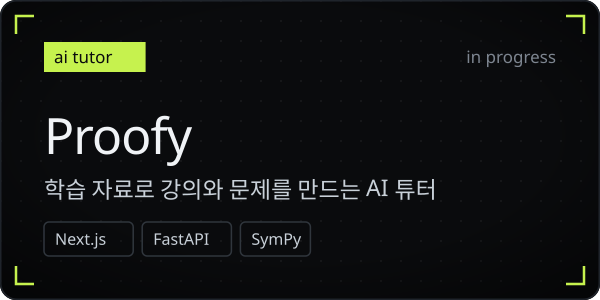
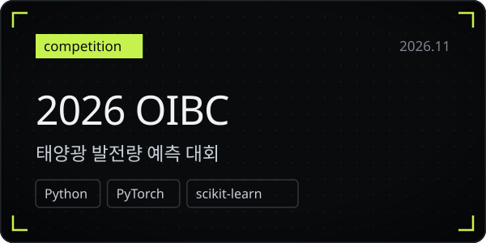
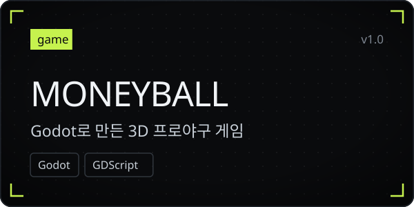
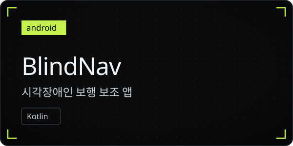
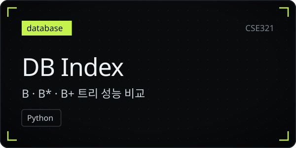
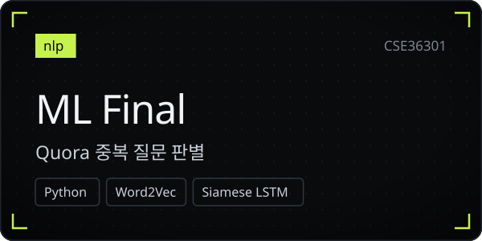

  

  
  

  
  

  
  

  <picture>
    <source media="(prefers-color-scheme: dark)" srcset="https://raw.githubusercontent.com/lilkimbab/lilkimbab/output/snake-dark.svg">
    <source media="(prefers-color-scheme: light)" srcset="https://raw.githubusercontent.com/lilkimbab/lilkimbab/output/snake.svg">
    
  </picture>

